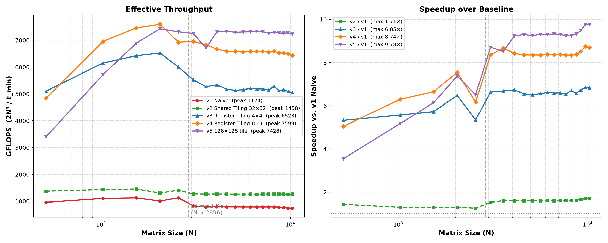

# CUDA SGEMM 在 RTX 5060 Laptop 上的调优

本仓库记录 SGEMM 从 naive 实现到 128×128 tile + 8×8 寄存器分块的优化过程，共五版。
所有性能数字都可以用 `benchmark.sh` 复现，原始数据在 `results/`；ncu 数据用「运行与复现」
里的命令采集，结果在 `results/ncu/`。最终在 RTX 5060 Laptop（sm_120，L2 = 32 MB）上达到
**7668 GFLOPS**，约为 naive 峰值的 **6.8 倍**，达到 cuBLAS 严格 FP32 的 **65%**
（N=2560 时达到 86%）。



## 各版本的峰值吞吐

| 版本 | 技术 | 峰值 GFLOPS |
| :--- | :--- | ---: |
| v1 | naive，每线程 1 个输出 | 1126 |
| v2 | shared memory tiling 32×32 | 1458 |
| v3 | 4×4 寄存器分块，block tile 32×32 | 6426 |
| v4 | 8×8 寄存器分块，block tile 64×64 | 7668 |
| v5 | 8×8 寄存器分块，block tile 128×128 | 7433 |
| **cuBLAS** | **严格 FP32（`CUBLAS_PEDANTIC_MATH`）** | **11717** |

相对 naive 的最大加速比（取各尺寸中的最大值，均出现在大 N）：
v2 **1.71×**、v3 **6.89×**、v4 **8.81×**、v5 **9.84×**。

## 每次更新的改动

| 版本 | 改动 | GFLOPS @N=1024 | 相对上一版 |
| :--- | :--- | ---: | ---: |
| v1 | naive，一个线程算一个数 | 987 | — |
| v2 | + shared memory 分块 32×32 | 1286 | 1.30× |
| v3 | + 4×4 寄存器分块 | 5605 | **4.36×** |
| v4 | + 8×8 分块（64 tile） | 6334 | 1.13× |
| v5 | 128 tile + k 步长 32 | 5152 | **0.81×**（波次量化） |
| cuBLAS | 严格 FP32 天花板 | 8395 | 1.63×（对 v5） |

按映射关系推算，`As[ty*4+i][k]` 在 warp 内跨 4 行、行跨距正好32 个 float，理论上构成 4 路 bank conflict；
但实测只差 0.08%（5591->5596）。冲突确实存在，只是这一项不是当前的限速环节（可能因为 `a[i]` 这几次读只占 L1 事务的一小部分，或编译器已做了合并，
待查）。padding 仍保留，成本为零，且在更大的分块下会成为必要条件。(独立单点测量，非本批数据)

## 文件

| 文件 | 说明 |
| :--- | :--- |
| `naive.cu` | v1 |
| `shared_memory.cu` | v2 |
| `register_tiling.cu` | v3（4×4，32 tile） |
| `register_tiling_8x8.cu` | v4（8×8，64 tile） |
| `register_tiling_v5.cu` | v5（8×8，128 tile，BK=32） |
| `benchmark.sh` | 20 个尺寸自动跑批 |
| `plot_scalability.py` | 由 `results/` 生成曲线 |
| `devinfo.cu` | 打印 GPU 型号、L2、SM 数 |
| `cublas_bench.cu` | cuBLAS 严格 FP32 基线（天花板参照） |

## 运行与复现

```bash
# 0. 设备信息（确认 GPU 型号 / L2 大小 / SM 数）
nvcc -O3 -arch=sm_120 devinfo.cu -o build/devinfo && ./build/devinfo

# 1. 正确性自检（N=128，输出 rel_err 与 PASS/FAIL）
nvcc -O3 -arch=sm_120 -DDSIZE=128 register_tiling.cu -o build/v3_128 && ./build/v3_128

# 2. 编译各版本（N=1024，供单点测试和 ncu 使用）
nvcc -O3 -arch=sm_120 -DDSIZE=1024 naive.cu                -o build/v1_1024
nvcc -O3 -arch=sm_120 -DDSIZE=1024 shared_memory.cu        -o build/v2_1024
nvcc -O3 -arch=sm_120 -DDSIZE=1024 register_tiling.cu      -o build/v3_1024
nvcc -O3 -arch=sm_120 -DDSIZE=1024 register_tiling_8x8.cu  -o build/v4_1024
nvcc -O3 -arch=sm_120 -DDSIZE=1024 register_tiling_v5.cu   -o build/v5_1024

# 3. 全套 20 个尺寸 → 写入 results/*.csv
bash benchmark.sh

# 4. 由数据生成曲线
python3 plot_scalability.py
```

ncu 数据用下面这条命令采集（换最后的可执行文件即可测不同版本）：

```
ncu --clock-control base --launch-skip 3 --launch-count 1 --section SpeedOfLight --metrics sm__throughput.avg.pct_of_peak_sustained_elapsed,l1tex__throughput.avg.pct_of_peak_sustained_elapsed,lts__throughput.avg.pct_of_peak_sustained_elapsed,dram__throughput.avg.pct_of_peak_sustained_elapsed,smsp__issue_active.avg.pct_of_peak_sustained_active ./build/v1_1024
```

`--launch-skip 3` 跳过前三次预热；`--clock-control base` 把 SM 锁在 1.21 GHz，所以 ncu 里的
Duration 比 benchmark 慢一倍，**绝对时间不可与 benchmark 混用，只看百分比**。

## 不同版本在做什么

- **v1 naive**：一个线程算一个输出，每做一次乘加都要从全局内存读两次数据。它的 L1/TEX 利用率
  在 N=1024 时就已经到 **97.52%**，是所有版本里最贴着上限的——问题从来不是"数据太大
  装不下"，而是每次乘加都要发两条加载指令，存取指令与计算指令的比例太大。

- **v2 shared memory 分块**：利用 shared memory 比全局访存快，把 32×32 的 tile 先搬进去，
  全局字节数降到 1/32。但在 N=1024 时 L2 利用率只有 6%，省下来的字节换不到时间；它实际
  赚到的是"同样两次访问，shared 比 global 便宜"（不用走 tag 查找与 miss 处理），L1 从
  97.5% 降到 87.5%，所以小 N 只快 **1.30×**。越过 L2 之后，字节数的优势才兑现，加速比
  升到 **1.61×**（N=8192）/ **1.70×**（N=10240）。
  关键在于：它**没有改变每 FMA 的加载次数**，仍然是 2 次——这也为 v3 提供了方向。

- **v3 4×4 寄存器分块**：一个线程一次算 16 个输出，8 次读取服务 16 次乘加，每 FMA 的加载次数
  从 2 降到 **0.5**，L1 事务量降到 1/4。N=1024 时 1286 → 5605 GFLOPS，**4.36×**，与
  "L1 事务降到 1/4"的预期吻合。同时 16 个累加器让同一线程内的指令不再互相等待
  （`issue_active` 从 21.56% 升到 50.99%），这是能把这部分收益吃满的前提，
  也是实测4.36略大于事务量减小带来的4倍的原因。但发射率不是提速的主要原因——主要原因仍然是降低了每 FMA 的加载次数。

- **v4 8×8 寄存器分块**：每线程 64 个输出，每 FMA 的加载次数再降到 **0.25**。但 64 个
  累加器让寄存器涨到 196，shared 涨到 33 KB，最终只放得下 3 个 block、192 线程，
  占用率掉到 **11.5%**（v3 是 31.5%）。此时虽然我们按照v3的ncu结果进一步降低了每个FMA的LSU，
  但是线程数目也大减，延迟隐藏做的更差，所以在N=2560时只涨到 7668，收益被占用率吃掉了大半，理论
  最高应该是接近两倍。因此下一步的优化方向也很明显，为了做好延迟隐藏，填补这次修改带来的occupancy
  下降，我们可以想法子增加线程。
     1.增大block内线程个数，但是此时tile大小变大，如果不改变shared的大小，会导致受到shared限制，导致block减半，实际收益就只有两倍，
  所以合理的方向应该是将步长也减半，平衡shared的翻倍，从而获得4倍的线程收益
     2.此时受限线程个数还有一个可能是寄存器被大量占用，如果想要避免这个问题，就要减小寄存器数目，pragma unroll只有在acc计算时复用最多，只保留这个，
  其余的尽量删掉，避免自动展开。

- **v5 128×128 tile + k 步长 32**：把 `BM/BN/BK` 拆开，用 128×128 的 tile 配 32 的 k 步长，
  block 变成 256 线程、寄存器压到 128，占用率升到 **33%**。峰值 7433 略低于 v4，但在大 N
  反而反超（N=10240 时约 7238 vs v4 的 6408）——因为它每字节的复用更高，越过 L2 之后
  更省 DRAM 带宽。下一步尝试的方向可以试着减小TT，从而进一步减小寄存器个数，代价是每FMA的LSU变成0.5

数据访问的层次是寄存器 > shared memory > 全局内存，速度依次下降。优化的核心是让数据尽量待在
更高层、并且被复用更多次——但要看清楚当前卡在哪一层，否则可能只降了"单价"却没降"次数"。

## 关键现象一：32 MB 是分界线

数据量小的时候（单个矩阵小于 32 MB），各个版本都不受容量限制；一旦超过 32 MB，曲线同时掉台阶。

这个 32 MB 可以用数据卡出来：

| N | 单矩阵大小 | naive | 4×4 寄存器分块 |
| ---: | ---: | ---: | ---: |
| 2560 | 26.2 MB | 1126 | 6425 |
| 3072 | 37.7 MB | 833 | 5671 |

26.2 MB 还很平稳、37.7 MB 立刻掉，说明分界线在两者之间；再用 `devinfo.cu` 打印
`l2CacheSize`，得到 32.0 MB，正好落在这个区间里。两边对上了，这个解释才成立。

顺带一个现象：越过 L2 之后，naive 对 v2 的劣势从 1.30× 拉到 1.70×，因为 naive 的全局流量
是 v2 的 32 倍，超容量后这部分直接变成 DRAM 开支；而 v3 对 v2 的优势几乎不变（4.36× → 4.16×），
因为它降的是 L1 访问次数，与数据装不装得进 L2 无关。

## 关键现象二：波次量化

GPU 一次能同时跑的 block 数有限，**时间只能按整数波计费**，除不尽的部分全部空转。
ncu 的 `Launch Statistics` 会直接把这个损失的上界算出来。

| 版本 | N | Grid | Waves Per SM | 尾部 block | ncu 估计尾部占比 | GFLOPS |
| :--- | ---: | ---: | ---: | ---: | ---: | ---: |
| v4 | 1024 | 256 | 3.28 | 23 | 25% | 5994 |
| v5 | 1024 | 64 | 1.23 | 13 | **50%** | 4932 |
| v5 | 2048 | 256 | 4.92 | 49 | 20% | 7152 |

v5 在 N=1024 只有 64 个 block，而每 SM 能放 2 个、共 52 个槽位——1.23 波的工作量被迫跑成 2 波，
ncu 估计这部分最多占一半运行时间。把 N 提到 2048（256 个 block、4.92 波）之后，同一个 kernel
从 4932 涨到 7152 GFLOPS，**+45% 完全来自"block 填得更满"**。

tile 越大这个问题越严重（block 数按 `(N/tile)²` 缩小），所以：

> **大 tile 的优势只能在大 N 上体现，小 N 永远吃亏。**
> 这也是 benchmark 必须扫多个尺寸、不能只看一个点的原因。

GFLOPS 为 ncu 锁频（1.21 GHz）下的数，只用于同口径比较，不与前文 benchmark 数字混用。

## ncu 数据

把 SM 锁在 1.21 GHz 后采集，N=1024（命令见「运行与复现」，原始输出在 `results/ncu/`）：

| 指标 | v1 | v2 | v3 | v4 | v5 |
| :--- | ---: | ---: | ---: | ---: | ---: |
| L1/TEX Cache | 97.52% | 87.45% | 92.55% | 72.61% | 85.02% |
| L2 Cache | 5.94% | 6.14% | 26.11% | 14.96% | 8.93% |
| DRAM | 0.58% | 0.76% | 3.43% | 3.63% | 3.10% |
| Compute (SM) | 95.95% | 86.03% | 71.06% | 45.72% | 48.28% |
| 占用率 | — | — | 31.5% | 11.5% | 33% |
| 每 FMA 加载次数 | 2 | 2 | 0.5 | 0.25 | 0.25 |

v5 那一列受尾部效应影响（见上一节），它"填满之后"的水平要看 N=2048：L1/TEX 90.14%、
Compute 61.81%、Duration 5.17 ms、7152 GFLOPS。

读表的三条结论：

1. **v1~v3 全部受 L1 限制**（87~97%），而 L2 与 DRAM 一直很低——瓶颈既不在显存带宽，也不在
   算力。v2 只快 1.30×，是因为它把访问的"单价"降了，没降"次数"。
2. **v4 把 L1 压到 72.6%，代价是占用率只剩 11.5%**：196 个寄存器 + 32.8 KB shared，每 SM
   只放得下 3 个 block × 64 线程 = 192 线程。两个指标都低于 80%，说明此时是"没人可派"，
   不是资源不够。
3. **v5 补上了占用率（33%），但 L1 又回到 85%**（N=2048 时 90.14%）——瓶颈再次回到 L1，
   和 v3 是同一层，只是每 FMA 的加载次数已经从 2 降到 0.25。

一个容易误读的地方：v1 的 Compute 95.95% 与它的 L1 97.52% 几乎相等，v2 的 86.03% 与 87.45%
也几乎相等——看起来像"算力打满了"。实际上 `sm__throughput` 取的是 SM 内**最忙的那个子单元**
的利用率，这里最忙的是加载单元（LSU），不是 FMA。所以"Compute 高"不等于"在算"。

## 和 cuBLAS 的差距

cuBLAS 用严格 FP32 模式、同样的数据、同样的测量方法跑一遍，当作天花板：

| N | cuBLAS | v1 | v2 | v3 | v4 | v5 |
| :--- | ---: | ---: | ---: | ---: | ---: | ---: |
| 1024 | 8395 | 11.8% | 15.3% | 66.8% | **75.4%** | 61.4% |
| 2560 | 8863 | 12.7% | 16.0% | 72.5% | **86.5%** | 83.8% |
| 8192 | 11717 | 6.7% | 10.8% | 45.1% | 56.4% | **62.1%** |

观察结论：

1. **N=2560 是最接近的尺寸**：v4 达到 cuBLAS 的 86.5%。此时矩阵还装得进 L2，比的是"谁把
   片上复用做得更彻底"，而这一点上 4×4 / 8×8 分块已经接近极限。
2. **越过 L2 之后差距迅速拉大**（8192 时只剩 56%）。而 cuBLAS 在同一段反而从 8863 涨到
   11717，本项目的所有 kernel 却全部掉台阶——说明cublas把 DRAM 流量和延迟处理得更好（更深的分块与
   流水），这是本项目还没做到的部分。
3. **v5 在大 N 反超 v4**（62.1% vs 56.4%），因为 128×128 的 tile 全局流量只有 v4 的一半，
   越依赖 DRAM 就越占优势。


## 为什么不先动 ILP

v1，v2、v3 的 Memory 都超过 80%，说明有资源已经被吃满。这时 ILP、TLP 这类延迟隐藏
的手段可以先放一边——它们只在"既没算满、也没搬满"的时候才是主角。ILP 在这里的作用只是
"确认它不是瓶颈"，确认完就可以放下。

issue_active 只反映发射槽的使用率，不反映做了多少有用功，v1 的 37.59% 高于 v2 的 21.56%，但 v1 更慢，因为它多出来的指令是全局寻址的算术，也不是当前主要因素——memory。

其次要说清 v2 → v3 里 ILP 为什么变了：4×4 分块让每个线程持有 16 个累加器（`TT×TT = 4×4`
个输出），同一线程内的 16 条累加不再互相等待，v2 中 FFMA 串行等待的开销被消掉了。所以去看
`issue_active` 会发现 v3（50.99%）明显高于 v2（21.56%）——但这是"减少加载次数"这个改动的
副产物，不是我们优化 v2 的出发点。

## 为什么选择减少寄存器

v4 的限制已经不是 L1（72.6%），而是延迟隐藏不足（占用率只有 11.5%）。196 个寄存器里有
70 多个是被 64 轮搬运循环全展开"提前抓进来"的 `a[]`、`b[]`——它们不承担任何复用，
只是让几条加载能重叠，收益很小。

去掉这个 `#pragma unroll` 会损失一点加载重叠，但寄存器从 196 降到 128，占用率从 11.5%
升到 33%。重叠的损失只发生在搬运阶段（占总时间几个百分点），占用率的收益覆盖整个 kernel，
所以这笔账是赚的。

## 下一步

v5 在 N=2048 时 L1/TEX 又回到 90.14%，说明瓶颈仍在 L1。而它目前的 shared 访问是 `PAD=0`：

- `As`：warp 内 2 个 `ty`，地址差 `8×32 = 256`，`256 % 32 = 0` → **2 路冲突**；
- `Bs`：16 个 `tx` 跨 128 个 float，取模后只有 4 个 bank 轮转 → **4 路冲突**。

bank conflict 会直接放大 L1 的 wavefront 数，所以下一步不是继续加大 tile，而是：

1. `PAD=1`，消掉 `As` 的 2 路冲突；
2. `b[]` 用 `float4`（`LDS.128`）读取，`Bs` 的 4 路大概率跟着消失。

更长远的方向是把寄存器压到 85 以下，让 v5 能吃满 3 个 block（768 线程、50% 占用率）；
但那需要把 `TT` 从 8 降到 4，每 FMA 的加载次数会退回 0.5，能不能划算要实测。

## 测量方法

一开始是单次计时，忽略了首次启动的 JIT 编译开销，把 1.95 ms 的 kernel 测成了 5.43 ms，据此
得出的"小尺寸下分块更慢"等结论都是错的。现在的方式是：**预热 3 次，再重复 20 次取最小值**
（同时记录平均值，两者差得多说明有降频）。

另一条：**同一份代码在不同批次之间会有约 10% 的波动**（v3 峰值曾测得 5931 与 6523），
所以本文所有数字都取自同一次跑批，不跨批次混用。

## 环境

RTX 5060 Laptop（8 GB，sm_120），L2 = 32 MB，CUDA 13.x，WSL2，
编译参数 `nvcc -O3 -arch=sm_120`。

## License

MIT
